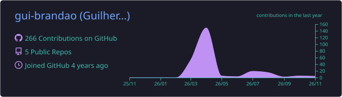

<h1>Olá, eu sou o Guilherme Brandão 👋</h1>

Desenvolvedor full-stack que constrói **produtos com IA para gestão, inovação e fomento**.
Trabalho com React, Next.js e TypeScript e desenvolvo sistemas usados no dia a dia de equipes:
painéis de gestão para incubadoras, ferramentas de apoio a editais de fomento, controle de jornada
e assistentes que interpretam linguagem natural.

  
  

## 🧠 IA no meu trabalho

Uso IA **dentro dos produtos**, não só para escrever código. A regra que sigo em todos eles:
**a IA interpreta e explica; os números e as regras vêm do código e do banco de dados.**

- **Interpretação de linguagem natural.** Mensagens em texto livre viram registros estruturados
  e validados (Structured Outputs + Zod) antes de chegar ao banco.
- **Análise de documentos.** Leitura de PDFs de editais e anexos para apontar elegibilidade,
  lacunas e contradições, sempre separando o dado coletado da interpretação do modelo.
- **Agentes agendados.** Tarefas recorrentes com IA que pesquisam editais de fomento abertos
  e gravam os resultados direto no banco do sistema.
- **Fallback sem IA.** Cadeia de provedores (OpenAI, Gemini, Groq, Cerebras) e modo
  determinístico quando nenhum está disponível, para o sistema continuar funcionando.
- **Desenvolvimento assistido por agentes.** Uso Claude Code no dia a dia, com instruções de
  projeto (`CLAUDE.md` / `AGENTS.md`), testes e revisão antes de cada entrega.

## 🚀 Projetos em destaque

| Projeto | O que resolve | Stack | Acesso |
| --- | --- | --- | --- |
| **Painel da Incubadora (V2)** | Centraliza a gestão de uma incubadora de startups: tarefas, mentorias, ciclo das startups, chat interno, relatório mensal em PDF e radar de editais abertos. | Next.js · TypeScript · Supabase · NextAuth · Google Sheets API · Vitest · Playwright | 🔒 Privado |
| **Agente de Fomento** | Pré-diagnóstico de oportunidades de fomento: chat consultivo, ranking auditável de editais e análise de aderência a partir do PDF do edital. | Next.js · React 19 · TypeScript · Tailwind · Zod · unpdf · Gemini / Groq / Cerebras | 🔒 Privado |
| **MoneyX (FINBOT)** | Assistente financeiro pessoal: registro de gastos em linguagem natural pelo Telegram, com dashboard web. A IA interpreta, o banco calcula. | Next.js 15 · TypeScript · Supabase (RLS) · OpenAI · Telegram Bot API · Recharts | 🔒 Privado |
| **Ponto Digital Sync8** | Controle de ponto e banco de horas com geolocalização, solicitações de ajuste/abono/férias, aprovação por gestor e relatórios mensais. | Next.js · TypeScript · Prisma · PostgreSQL · NextAuth · bcrypt · Web Push | 🔗 [Acessar](https://pontodigital-sync8.vercel.app/) |
| **Ponto Eletrônico (React + Supabase)** | Versão do sistema de ponto com perfis por cargo, fechamento de período pela gestão e importação de histórico via CSV. | React · TypeScript · Vite · Supabase · shadcn/ui · Papaparse | 🔒 Privado |
| **Portal de Editais** | Portal de inscrição em editais com formulário em etapas, área administrativa e CRM das empresas inscritas. | React · TypeScript · Vite · shadcn/ui · React Hook Form · Zod | 🔒 Privado |
| **Jornada de Incubação** | Linha do tempo interativa para o onboarding de startups incubadas, com modo apresentação. | React 19 · Vite · JavaScript | 🔒 Privado |
| **Painel Consolidado de Indicadores** | Mockup de um painel único que reúne indicadores de várias áreas de um parque tecnológico, com seletor de período e modo apresentação. | HTML · CSS · JavaScript · ECharts | 🔗 [Repositório](https://github.com/gui-brandao/mockup-indicadores) |

**Em desenvolvimento:** uma plataforma de leads B2B e uma API de consulta a dados do INPI.

## 🛠️ Tecnologias

  
  
  
  
  
  
  
  
  
  
  
  

  
  
  
  
  
  
  
  

## 📊 Estatísticas

  
  

  

Se o serviço externo de estatísticas estiver fora do ar, o resumo acima continua aparecendo: ele é gerado por uma GitHub Action e salvo neste repositório.

Estudos iniciais

Projetos de prática em HTML, CSS e JavaScript do começo da minha trajetória:
[Ping-Pong-JS](https://github.com/gui-brandao/Ping-Pong-JS) ·
[alura-midi-dj](https://github.com/gui-brandao/alura-midi-dj) ·
[projeto_alura_plus](https://github.com/gui-brandao/projeto_alura_plus)

---

Sempre construindo sistemas úteis, bem estruturados e fáceis de usar. Vamos conversar pelo [LinkedIn](https://br.linkedin.com/in/guilhermebrandao8).
